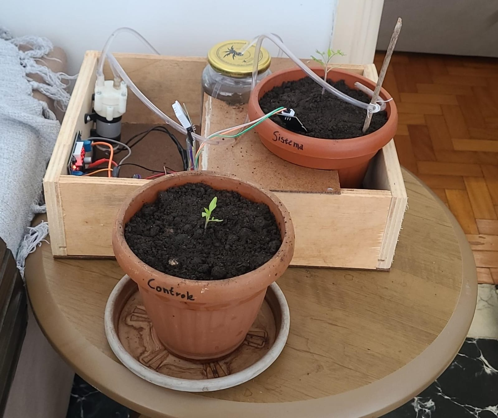

# Irrigador Inteligente — Sistema de Irrigação Automatizada com Controle PID e IoT

**Projeto de Trabalho de Conclusão de Curso — Engenharia de Computação**

Desenvolvimento de um sistema de irrigação automatizada utilizando sensores de umidade do solo, microcontrolador ESP32, controlador PID e monitoramento remoto por meio da plataforma Blynk.

---

## Sobre o projeto

O Irrigador Inteligente consiste no desenvolvimento de um sistema automatizado para monitorar e controlar a umidade do solo, utilizando um controlador PID para ajustar o acionamento de uma bomba d'água de acordo com a necessidade de irrigação.

O sistema utiliza um ESP32 para realizar a leitura dos sensores, processar as informações e controlar o funcionamento da bomba. O monitoramento remoto e a configuração dos parâmetros do controlador são realizados por meio da plataforma Blynk.

Além do desenvolvimento do protótipo, foi realizada uma etapa experimental com o cultivo de tomate-cereja, comparando o funcionamento da irrigação automatizada com o método manual.

## Objetivos

- Desenvolver um sistema de irrigação automatizada.
- Monitorar a umidade do solo por meio de um sensor capacitivo.
- Implementar um controlador PID para regular o acionamento da bomba.
- Permitir o monitoramento remoto e a configuração dos parâmetros por meio de uma plataforma IoT.
- Avaliar experimentalmente o funcionamento do sistema.
- Comparar o consumo de água entre a irrigação automatizada e a manual.

## Funcionamento do sistema

O funcionamento do irrigador começa com a leitura da umidade do solo realizada pelo sensor capacitivo HW-390. Os dados são enviados ao ESP32, que compara a umidade medida com o valor de referência configurado.

Com base na diferença entre esses valores, o controlador PID calcula a intensidade de acionamento da bomba. O sinal de controle é aplicado por meio de PWM, utilizando a ponte H L298N, permitindo ajustar o funcionamento da bomba de acordo com a necessidade de irrigação.

O processamento do controlador é realizado localmente no ESP32, enquanto as informações de funcionamento são enviadas à plataforma Blynk para monitoramento remoto. A plataforma também permite alterar parâmetros do controlador, como o valor de referência e os ganhos PID.

## Componentes utilizados

- ESP32
- Sensor capacitivo de umidade do solo HW-390
- Sensor de temperatura e umidade do ar DHT22
- Ponte H L298N
- Bomba d'água RS-385 (12 V)
- Reservatório de água
- Mangueira para irrigação
- Fonte de alimentação e regulador de tensão

## Tecnologias utilizadas

- C++ 
- Arduino IDE
- ESP32
- Blynk IoT
- Controle PID
- PWM

## Registros do projeto

Nesta seção estão disponíveis fotografias e vídeos que demonstram as etapas de desenvolvimento, montagem e funcionamento do protótipo.

### Fotografias

<strong>Sistema de irrigação</strong> 

  

<strong>Medição de umidade – Controle manual</strong> 

  

<strong>Medição de umidade – Sistema automatizado</strong> 

  

<strong>Dashboard de monitoramento – Blynk</strong> 

### Vídeos demonstrativos

#### Funcionamento da irrigação automatizada

[▶ Assistir ao vídeo de funcionamento do irrigador](https://brunorz03.github.io/irrigador-inteligente-tcc/video.html)

## Código-fonte

O código-fonte utilizado no desenvolvimento do sistema está disponível neste repositório. Ele contém a implementação do controlador PID, a leitura dos sensores, o acionamento da bomba por PWM e a comunicação com a plataforma Blynk.

## Resultados experimentais

A avaliação experimental foi realizada por meio da comparação entre dois métodos de irrigação: o sistema automatizado e a irrigação manual.

Durante os testes, o sistema automatizado apresentou ciclos diários de irrigação com volumes aproximados de 30 a 40 mL por ciclo. Já o método manual utilizou aproximadamente 190 mL a cada 48 horas.

Também foram acompanhadas as condições de umidade do solo e o desenvolvimento das plantas ao longo do experimento. A comparação considerou os registros de consumo de água e as observações realizadas durante o cultivo.

A avaliação foi realizada com um vaso para cada método de irrigação, o que representa uma limitação experimental e restringe a abrangência da comparação entre o desenvolvimento das plantas.

## Documentação completa

O documento completo do Trabalho de Conclusão de Curso está disponível abaixo:

**[Visualizar TCC em PDF](documentos/TCC.pdf)**

## Autores

- Bruno Ricci Zanoni
- Giulio Passetti Figueiredo

**Instituição:** Universidade São Francisco (USF)  
**Curso:** Engenharia de Computação  
**Orientador:** Luiz Carlos Freitas Júnior

---

Este repositório reúne o código-fonte, os registros visuais e a documentação complementar desenvolvidos durante a realização do Trabalho de Conclusão de Curso.
